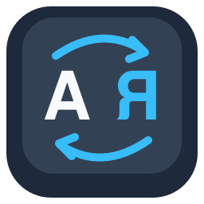

<p align="center"></p>

# Flipkey

Flipkey fixes words you typed in the wrong keyboard layout on macOS, the way Punto Switcher does.
Type `ghbdtn`, press Space, and it becomes `привет`. It works in both directions, Russian and English.
While it runs, an A⇄Я icon sits in the menu bar; click it for About or Quit.

When you press Space, Enter, Tab or a sign like `?` or `!`, Flipkey looks at the last word in both layouts.
If the word looks wrong in the current layout but is a real word in the other one, Flipkey retypes it and switches the layout.
It switches to the layout you last used for that language, so it keeps ABC or U.S., Russian or Russian – PC, as you had them.
Short words typed just before it in the same wrong layout get fixed too, so `b lfdfq` becomes `и давай`.

Tap Shift twice quickly (a Shift you hold or use with a click doesn't count) to:

- undo the last fix, right after it happened, if Flipkey got it wrong;
- convert the word you are typing, or the last word if Flipkey left it alone (a name, slang), together with short words like `b` (и) typed before it in the same wrong layout; press again to flip it back;
- with text selected, retype the selection in the other layout and switch to that layout.

A word "looks wrong" when the macOS spell checker rejects it or when it has no vowels.
The vowel rule matters because the spell checker slowly learns words you type often, including mistyped ones like `ghbdtn`.

## Install

Download `Flipkey-<version>.zip` from Releases, unzip it, and move `Flipkey.app` to Applications.
The app is not notarized yet, so open it the first time with right-click > Open.
Then allow it in System Settings > Privacy & Security > Accessibility. It starts working as soon as you allow it.

## Build

```bash
./build.sh 0.1    # runs the self-test, then builds build/Flipkey.app and build/Flipkey-0.1.zip
```

The app runs on macOS 13 or later, on both Apple Silicon and Intel.
If your keychain has a code-signing certificate named "Flipkey Dev", the build signs with it, and the Accessibility grant survives rebuilds.
Without it the build is ad-hoc signed, and macOS silently drops the grant after every rebuild.

## Limits

- It supports only the ABC/US and Russian (ЙЦУКЕН) layouts.
- Double Shift reads the selection through the clipboard and then restores it. Apps that copy the whole line when nothing is selected (VS Code) get that line inserted.
- Double Shift also triggers whatever else listens for it, such as Search Everywhere in JetBrains IDEs.
- It ignores `ё` and Russian punctuation keys.
- It leaves alone words the spell checker doesn't know, such as names and slang.
- A short word on its own, like `b` for `и`, is too ambiguous to fix; it is fixed only together with the next word.
